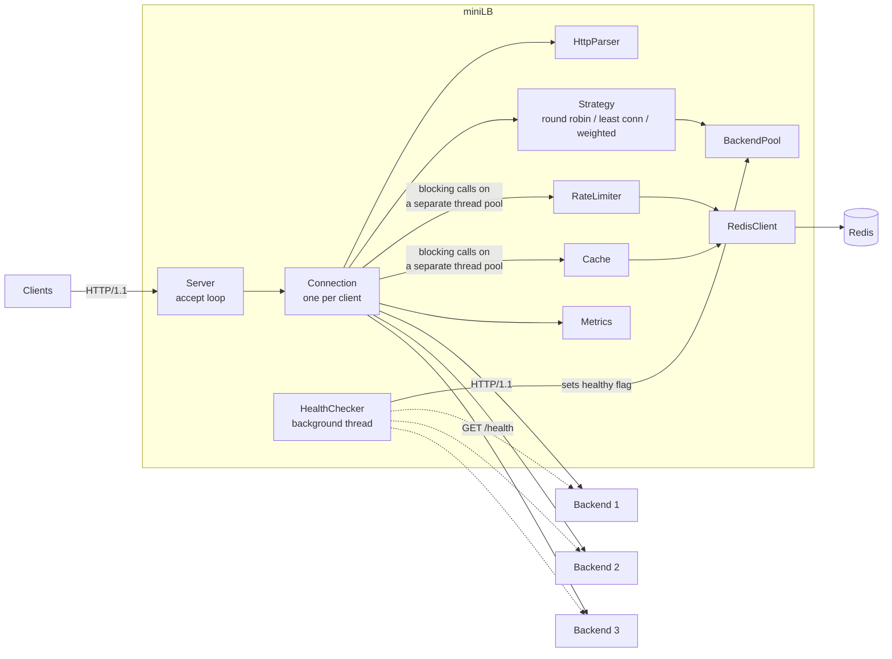
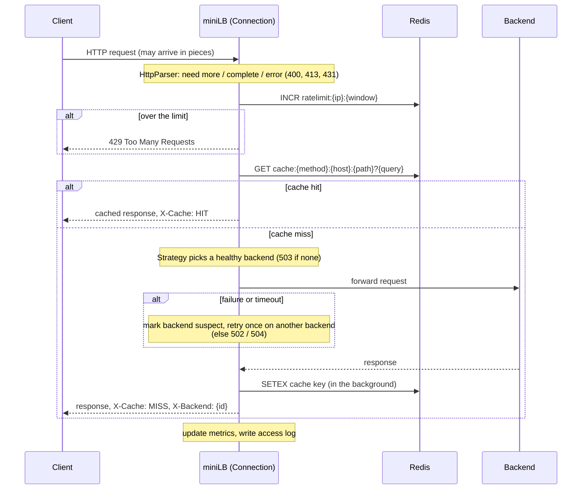

# miniLB

[](https://github.com/panther-0707/Redis/actions/workflows/ci.yml)

A small HTTP/1.1 reverse proxy and Layer-7 load balancer written in C++17 with
Boost.Asio, using Redis for response caching and rate limiting.

It accepts many concurrent client connections, parses each HTTP request,
rate-limits clients, serves cached responses from Redis, and otherwise forwards
the request to a healthy backend chosen by a configurable algorithm. A
background health checker removes and re-adds backends automatically, and
`GET /stats` exposes live metrics.

**Contents:** [Features](#features) · [Architecture](#architecture) ·
[Quick start](#quick-start) · [Try it](#try-it) · [Configuration](#configuration) ·
[HTTP behaviour](#http-behaviour) · [Project layout](#project-layout) ·
[Testing](#testing) · [Benchmarks](#benchmarks) ·
[Design decisions](#design-decisions) · [Known limitations](#known-limitations)

## Features

- **Asynchronous I/O**: one Boost.Asio `io_context` running on N worker threads; no thread per connection.
- **Three balancing algorithms**: round robin, least connections, weighted round robin (Strategy pattern).
- **Health checks**: active probes (`GET /health`) with failure/success thresholds, plus passive detection from failed requests.
- **Failover**: a request that hits a failing backend is retried once on another backend.
- **Redis cache**: cacheable `GET` responses are stored with a TTL; hits are answered without touching a backend.
- **Redis rate limiting**: fixed window per client IP, `429` with `Retry-After`.
- **Fail-open**: if Redis is down, miniLB keeps proxying without cache and rate limiting.
- **Deadlines everywhere**: connect, read and write timeouts; request and response size caps.
- **Observability**: `GET /stats` (JSON), one access-log line per request (spdlog).
- **Graceful shutdown** on `SIGINT`/`SIGTERM`: in-flight requests finish first.
- **Tested**: 107 unit tests and 25 integration tests, run under ThreadSanitizer and AddressSanitizer + UBSan in CI.

## Architecture

### Components



### Life of a request



### Threads

| Threads | Count | What runs there |
| --- | --- | --- |
| I/O threads (`EventLoop`) | `threads` (default 4) | All socket and timer handlers. Never block. |
| Blocking pool (`ThreadPool`) | `redis.threads` (default 4) | Blocking Redis calls (rate limit, cache get/put). |
| Health checker | 1 | Probes every backend each `interval_ms`. |
| Main thread | 1 | Starts everything, then waits for shutdown. |

A request hops between them like this: the I/O thread parses the request, hands
the Redis work to the blocking pool, and the pool posts the result back to the
connection's strand on an I/O thread, where the proxying continues.

### Shared state and how it is protected

| State | Protection |
| --- | --- |
| Per-connection state (sockets, buffers, parsers, timer) | One Asio **strand** per connection: its handlers never run concurrently, so no lock is needed. |
| `Backend::healthy`, `activeConnections`, `totalRequests`, failure/success streaks | `std::atomic` |
| The list of backends | Immutable after startup, so reads need no lock. |
| Strategy counters (round robin position) | `std::atomic` |
| `Metrics` counters | `std::atomic` |
| `ThreadPool` task queue | `std::mutex` + `std::condition_variable` (tasks run outside the lock) |
| `HealthChecker` stop flag | `std::mutex` + `std::condition_variable` (never held during network I/O) |
| Server acceptor, signal set, shutdown timers | One Asio strand |
| Redis connections | redis-plus-plus internal connection pool (thread-safe) |
| Redis back-off timestamp | `std::atomic` |
| `Config` | Read-only after startup |
| Logging | spdlog multi-threaded sink |

## Quick start

### With Docker

```bash
docker compose up --build
```

This starts Redis, three demo backends and miniLB on <http://localhost:8080>.

### Local build

Requirements (Ubuntu 24.04 package names): a C++17 compiler, CMake ≥ 3.16 and

```bash
sudo apt-get install -y cmake g++ git \
    libboost-dev libhiredis-dev libyaml-cpp-dev libspdlog-dev libgtest-dev \
    redis-server wrk
```

redis-plus-plus is downloaded and built by CMake automatically if it is not
installed (so the first configure needs internet access).

```bash
scripts/build.sh          # Release build into ./build
scripts/run_demo.sh       # Redis + 3 demo backends + miniLB on :8080 (Ctrl-C stops all)
```

Or start the pieces by hand:

```bash
redis-server --save "" &
./build/demo_backend --port 8001 --name backend-1 &
./build/demo_backend --port 8002 --name backend-2 &
./build/demo_backend --port 8003 --name backend-3 &
./build/miniLB --config config/config.yaml
```

## Try it

```bash
# Load balancing: X-Backend shows which backend answered.
# (Different query strings, so that the cache does not answer.)
for i in 1 2 3 4 5 6; do curl -si "localhost:8080/?n=$i" | grep X-Backend; done

# Caching: first request is a MISS, the repeat is a HIT.
curl -si localhost:8080/ | grep X-Cache
curl -si localhost:8080/ | grep X-Cache

# /slow sleeps 2 s in the backend; the second call is answered from Redis.
time curl -s localhost:8080/slow
time curl -s localhost:8080/slow

# Rate limiting: the default is 100 requests per minute per client IP.
for i in $(seq 1 120); do curl -s -o /dev/null -w '%{http_code}\n' localhost:8080/; done | sort | uniq -c

# Live metrics.
curl -s localhost:8080/stats

# Failover: kill a backend and keep sending requests (scripted version below).
benchmarks/failover_demo.sh
```

Example `/stats` output:

```json
{
  "total_requests": 7,
  "active_connections": 1,
  "cache_hits": 1,
  "cache_misses": 5,
  "rate_limited": 0,
  "errors": 1,
  "algorithm": "round_robin",
  "redis_available": true,
  "backends": [
    {"id": "127.0.0.1:8001", "healthy": true, "weight": 1, "active_connections": 0, "requests": 2},
    {"id": "127.0.0.1:8002", "healthy": true, "weight": 1, "active_connections": 0, "requests": 2},
    {"id": "127.0.0.1:8003", "healthy": true, "weight": 2, "active_connections": 0, "requests": 1}
  ]
}
```

The demo backend (`backends/demo_backend.cpp`) serves `GET /` ("Hello from
\<name\>!"), `GET /health`, `GET /slow` (waits 2 s), `GET /work` (blocks the
backend for 1 ms, for benchmarks) and `POST /echo` (returns the body).

## Configuration

`miniLB --config <file>` (default `config/config.yaml`). Only `backends` is
required. Unknown keys and invalid values are rejected at startup.

| Key | Default | Meaning |
| --- | --- | --- |
| `listen_port` | `8080` | Port to listen on. |
| `algorithm` | `round_robin` | `round_robin`, `least_connections` or `weighted`. |
| `threads` | `4` | I/O worker threads. |
| `log_level` | `info` | `trace`, `debug`, `info`, `warn`, `error`, `off`. |
| `shutdown_grace_ms` | `5000` | How long in-flight requests may finish after SIGINT/SIGTERM. |
| `backends[].host`, `.port`, `.weight` | weight `1` | Backend address; `weight` is used by `weighted`. |
| `health_check.path` | `/health` | Probed with `GET`; any 2xx is healthy. |
| `health_check.interval_ms` | `2000` | Time between probe rounds. |
| `health_check.timeout_ms` | `1000` | Deadline for one probe. |
| `health_check.fail_threshold` | `3` | Consecutive failures before a backend is removed. |
| `health_check.success_threshold` | `2` | Consecutive successes before it is added back. |
| `rate_limit.requests` | `100` | Requests per client IP per window; `0` disables. |
| `rate_limit.window_seconds` | `60` | Window length. |
| `cache.enabled` | `true` | Turn the response cache on or off. |
| `cache.ttl_seconds` | `30` | Lifetime of a cache entry. |
| `cache.max_entry_bytes` | `1048576` | Larger response bodies are not cached. |
| `timeouts_ms.connect` | `1000` | Connecting to a backend. |
| `timeouts_ms.read` | `5000` | Receiving a whole request / a whole backend response. |
| `timeouts_ms.write` | `5000` | Sending a whole request / response. |
| `limits.max_request_header_bytes` | `16384` | Larger request heads get `431`. |
| `limits.max_request_body_bytes` | `1048576` | Larger request bodies get `413`. |
| `limits.max_response_bytes` | `8388608` | Larger backend responses get `502`. |
| `redis.host`, `redis.port` | `127.0.0.1`, `6379` | Redis server. |
| `redis.timeout_ms` | `200` | Connect/command timeout before failing open. |
| `redis.threads` | `4` | Blocking-pool threads and Redis connections. |

## HTTP behaviour

Response headers added by miniLB:

| Header | Values |
| --- | --- |
| `X-Cache` | `HIT` (served from Redis), `MISS` (looked up, not found), `BYPASS` (not cacheable or cache disabled) |
| `X-Backend` | `host:port` of the backend that answered (absent on cache hits) |
| `Retry-After` | Seconds until the rate-limit window ends (on `429`) |

Request headers sent to backends: `X-Forwarded-For` (client IP appended) and
`Connection: close`.

Status codes generated by miniLB itself:

| Code | When |
| --- | --- |
| `400` | Malformed request |
| `413` | Request body larger than `max_request_body_bytes` |
| `429` | Client is over its rate limit |
| `431` | Request headers larger than `max_request_header_bytes` |
| `501` | Chunked request body (not implemented) |
| `502` | Backend unreachable, or it sent an invalid or oversized response |
| `503` | No healthy backend |
| `504` | Backend timed out |

Everything else (including backend `4xx`/`5xx`) is passed through unchanged.

What is cached: `GET` requests without `Authorization` or `Cookie` headers,
when the response is `200`, has no `Set-Cookie` or `Vary` header, is not marked
`no-store`, `no-cache` or `private`, and fits in `max_entry_bytes`.

Redis keys: `cache:<method>:<host>:<path>?<query>` (value: the serialized
response, expiring after the TTL) and `ratelimit:<ip>:<window>` (a counter
that expires with its window).

## Project layout

```
CMakeLists.txt             build: library + miniLB + demo_backend + tests
Dockerfile                 two-stage image with miniLB and demo_backend
docker-compose.yml         Redis + 3 demo backends + miniLB
config/
  config.yaml              default configuration (local)
  config.docker.yaml       same, with docker-compose host names
include/miniLB/            headers (src/ mirrors this tree)
  core/
    Server                 accept loop, graceful shutdown
    Connection             one client request, start to finish (the proxy logic)
    EventLoop              io_context running on N threads
    ThreadPool             generic worker pool (also used for blocking Redis calls)
  http/
    Headers                case-insensitive header list helpers
    HttpRequest/Response   plain structs + serialize()
    HttpParser             incremental request parser and response parser
  balancer/
    Backend                one upstream server (atomics for health and load)
    BackendPool            all backends; healthy() snapshot
    Strategy               interface + makeStrategy() factory
    RoundRobin, LeastConnections, WeightedRoundRobin
  health/
    HealthChecker          background probe thread
  redis/
    RedisClient            KeyValueStore interface + fail-open Redis implementation
    Cache                  response cache
    RateLimiter            fixed-window limiter
  util/
    Config                 settings struct + YAML loader
    Logger                 spdlog setup
    Metrics                atomic counters -> /stats JSON
src/main.cpp               wires everything together
backends/demo_backend.cpp  tiny HTTP server to balance across
tests/unit/                GoogleTest unit tests (no network needed)
tests/integration/         tests against real miniLB, backend and Redis processes
benchmarks/                run_benchmark.sh (wrk), failover_demo.sh
scripts/                   build.sh, run_demo.sh
.github/workflows/ci.yml   Release, TSan, ASan+UBSan and Docker jobs
```

## Testing

```bash
scripts/build.sh
ctest --test-dir build --output-on-failure      # unit + integration tests

./build/unit_tests                              # 107 tests, no network or Redis needed
./build/integration_tests                       # 25 tests, starts real processes
./build/integration_tests --gtest_filter='*Failover*'
```

The integration tests start miniLB, demo backends and a private `redis-server`
on free ports. Tests that need Redis are skipped if `redis-server` is not
installed; set `MINILB_REQUIRE_REDIS=1` to make that a failure instead (CI does).

### Sanitizers

```bash
scripts/build.sh build-tsan -DMINILB_SANITIZER=thread  -DCMAKE_BUILD_TYPE=RelWithDebInfo
ctest --test-dir build-tsan --output-on-failure

scripts/build.sh build-asan -DMINILB_SANITIZER=address -DCMAKE_BUILD_TYPE=RelWithDebInfo
ctest --test-dir build-asan --output-on-failure
```

`thread` enables ThreadSanitizer; `address` enables AddressSanitizer (with leak
detection) and UndefinedBehaviorSanitizer. Every integration test requires
miniLB to exit with code 0, and a sanitizer report makes it exit non-zero, so
the integration suite is also the sanitizer run for the whole request path.

To put a sanitizer build under load, point the benchmark script at it:

```bash
BUILD_DIR=build-tsan DURATION=10s benchmarks/run_benchmark.sh
```

If ThreadSanitizer aborts at startup with "unexpected memory mapping", lower
the kernel's address randomisation first: `sudo sysctl vm.mmap_rnd_bits=28`.

## Benchmarks

```bash
scripts/build.sh
benchmarks/run_benchmark.sh                       # wrk -t4 -c200 -d30s per scenario
DURATION=10s CONNECTIONS=100 benchmarks/run_benchmark.sh
```

The script starts its own backends, miniLB and Redis on private ports, runs
`wrk` against six scenarios, prints a summary table and stores the raw `wrk`
output in `benchmarks/results/`. Rate limiting is switched off for the run
(otherwise almost every request would be a `429`).

### Sample results

One run of the script on the machine this project was developed on: a 2-vCPU
cloud VM (Intel Xeon 2.30 GHz, Linux 6.18, GCC 13.3, Release build), with
`wrk`, miniLB, the backends and Redis all sharing those two cores.
`wrk -t4 -c200 -d30s`, 4 miniLB I/O threads.

| Scenario | Requests/s | p50 | p99 | Non-2xx |
| --- | ---: | ---: | ---: | ---: |
| `direct`: wrk → one backend, no load balancer | 51,643 | 3.20 ms | 7.76 ms | 0 |
| `lb-1-backend`: miniLB → 1 backend, `GET /` | 19,224 | 10.08 ms | 16.18 ms | 0 |
| `lb-3-backends`: miniLB → 3 backends, `GET /` | 16,766 | 11.57 ms | 18.67 ms | 0 |
| `work-1-backend`: miniLB → 1 backend, `GET /work` | 875 | 227.57 ms | 240.07 ms | 0 |
| `work-3-backends`: miniLB → 3 backends, `GET /work` | 2,660 | 76.33 ms | 83.74 ms | 0 |
| `lb-cache`: miniLB with Redis cache → 3 backends, `GET /` | 24,222 | 7.95 ms | 14.51 ms | 0 |

How to read them:

- **These are numbers from one small shared VM, not a statement about what
  miniLB can do on real hardware.** Run the script on your own machine before
  quoting anything.
- `GET /` is so cheap for the backend that miniLB itself is the bottleneck, so
  going from 1 to 3 backends does not help (it is slightly slower here because
  three backend processes compete for the same two cores).
- `GET /work` makes each backend the bottleneck (it can serve about 1,000
  requests/s). There, three backends give about three times the throughput of
  one (2,660 vs 875 requests/s), which is the effect a load balancer is for.
- Proxying costs throughput compared with `direct` because every request
  through miniLB opens a new TCP connection to a backend (no keep-alive or
  connection pooling yet, see [Known limitations](#known-limitations)).
- With the cache on, hits skip the backend connection entirely, which is why
  `lb-cache` is faster than `lb-3-backends`.

### Failover demo

```bash
benchmarks/failover_demo.sh
```

Sends requests through miniLB while backend-2 is killed with `kill -9` and
later restarted, printing which backend served each request and the health
flags from `/stats`.

## Design decisions

**Asynchronous I/O instead of a thread per connection.** Thousands of mostly
idle connections cost only memory, not threads. One `io_context` runs on N
threads; a thread is only busy while a handler is actually executing.

**One strand per connection instead of mutexes.** Each accepted socket gets its
own Asio strand, and the backend socket, resolver and timer of that connection
share it. All handlers of one connection therefore run one at a time, so
`Connection` has no locks at all, while different connections still run in
parallel.

**Lifetime through `shared_ptr`.** Every pending async operation holds a
`shared_ptr` to its `Connection` (`enable_shared_from_this`). When the last
operation finishes, the connection is destroyed automatically. There is no
manual `delete` and no connection registry.

**Blocking Redis client on its own thread pool.** redis-plus-plus is
synchronous. Calling it from an I/O thread would stall every connection served
by that thread, so Redis calls are submitted to a separate `ThreadPool` and the
result is posted back to the connection's strand. The rate-limit check and the
cache lookup share one hop to keep the overhead to one round trip between
threads. The cache write after a miss is fire-and-forget, so the client never
waits for it.

**Fail-open on Redis errors.** The cache and the rate limiter are optimisations
and protection, not correctness requirements. If Redis is unreachable, calls
return "unavailable", a warning is logged, and Redis is left alone for one
second (a tiny circuit breaker) so that requests do not each pay a connect
timeout. The trade-off: while Redis is down, nobody is rate limited.

**Immutable backend list, atomic backend state.** Backends are fixed at
startup, so the list is read without any lock. Only per-backend flags and
counters change, and those are atomics. A snapshot of healthy backends can be
slightly stale; the retry logic covers that window.

**Active and passive health checking share one counter.** The health checker
needs `fail_threshold` consecutive failed probes to remove a backend, which
avoids flapping. A failed real request counts as a failure too ("marking the
backend suspect"), so a dead backend is usually removed before the next probe
round. Backends start out healthy so the balancer works from the first second.

**Retry once, and only when it is safe.** After a failure the request goes to
one other backend. If the request may already have reached the first backend,
it is only retried for idempotent methods (`GET`, `HEAD`, `OPTIONS`, `PUT`,
`DELETE`); a `POST` is not repeated, because the first backend may have acted
on it.

**One deadline timer per connection.** Each phase (read request, connect, send,
read response, send reply) arms the same timer. If it expires, the relevant
socket is closed, which makes the pending operation fail at once. A generation
counter ignores a timer callback that was already queued when its phase ended,
which is the classic race in this pattern.

**Incremental parser with strict input checks.** TCP delivers a byte stream, so
the parser accepts any fragment and answers "need more", "complete" or "error".
It rejects conflicting `Content-Length` headers, spaces in header names and
folded header lines, which are the usual ingredients of request smuggling, and
it enforces size caps before buffering a body.

**Fixed-window rate limiting.** One `INCR` per request on
`ratelimit:<ip>:<window>` plus `EXPIRE` on the first increment. It is the
simplest correct scheme and works across several miniLB instances because the
count lives in Redis. The trade-off is that a client can send up to twice the
limit across a window boundary; a sliding window or token bucket would fix that.

**Conservative caching.** Only plain `GET`s without credentials are looked up,
and only shareable `200` responses are stored. It is better to miss the cache
than to hand one user's page to another.

**`Connection: close` on both sides.** One request per connection keeps the
state machine short and easy to reason about. The cost is a TCP handshake per
request, visible in the benchmark; keep-alive and backend connection pooling
are the first items on the stretch list.

**`KeyValueStore` interface in front of Redis.** `Cache` and `RateLimiter`
depend on three small operations rather than on redis-plus-plus, so their unit
tests run against an in-memory fake with no Redis server.

## Known limitations

- **No keep-alive, no connection pooling.** Every request uses a fresh client
  connection and a fresh backend connection.
- **HTTP subset.** HTTP/1.x only; no TLS, HTTP/2, WebSockets, `Expect:
  100-continue` or pipelining. Chunked *request* bodies are rejected with `501`.
  Chunked *responses* are passed through untouched and rely on the backend
  closing the connection (it is asked to with `Connection: close`).
- **Responses are buffered in memory**, not streamed, up to `max_response_bytes`
  per request.
- **Backends are fixed at startup.** No service discovery or config reload.
- **Rate limiter**: fixed-window burst at window boundaries; `INCR` and `EXPIRE`
  are two commands rather than one atomic script; keyed by the TCP peer address,
  so clients behind one NAT or proxy share a budget; allows everything while
  Redis is down.
- **Cache**: no `Vary` support (such responses are simply not cached), no
  revalidation, no manual invalidation; when an entry expires, concurrent
  requests all miss until the first response is stored again (cache stampede).
- **Timeouts count as health failures.** A legitimately slow endpoint that
  exceeds `timeouts_ms.read` adds a strike against its backend, and an oversized
  response does too.
- **Health probes run one backend after another**, and their DNS lookup has no
  timeout of its own. Fine for a handful of backends.
- **Weighted round robin is not "smooth"**: with weights 1/1/2 the order is
  A, B, C, C rather than interleaved.
- **Early error replies can be lost.** If miniLB rejects a request while the
  client is still sending (for example a huge header), closing the socket with
  unread data can reset the connection before the client reads the error.
- **`/stats` is unauthenticated** and served on the public port.
- **Linux only**; built and tested with GCC 13 on Ubuntu 24.04.

## Stretch goals

Keep-alive and backend connection pooling, TLS termination, hot config reload
(`SIGHUP`), Prometheus `/metrics`, consistent hashing, a circuit breaker per
backend, sliding-window or token-bucket rate limiting.
